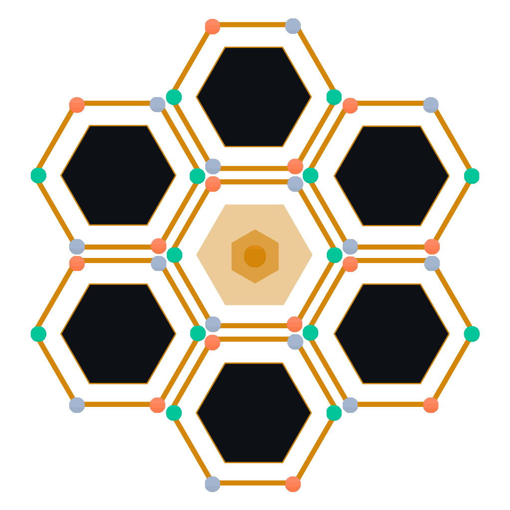

<p align="center">
  
</p>

<h1 align="center">HoneyML</h1>

<p align="center">
  Inteligencia de amenazas con honeypots y un motor de triaje con agentes.
</p>

<p align="center">
  <a href="LICENSE"></a>
  
  <a href="https://www.honeyml.com.ar"></a>
</p>

HoneyML es una plataforma open source de inteligencia de amenazas construida sobre honeypots de baja
interacción. Cowrie emula un servidor SSH y Telnet, y Dionaea expone SMB, HTTP, FTP, MySQL y MSSQL,
entre otros servicios. Lo que registran se normaliza al Elastic Common Schema (ECS) y se indexa en
Elasticsearch. Los eventos en los que el atacante hizo algo pasan además por un bus a un motor de
triaje con agentes, escrito con LangGraph, que los clasifica por severidad y por táctica de MITRE
ATT&CK y deja escrita la evidencia en la que se apoya. Un panel web educativo muestra qué llega a
los sensores y qué decidió el motor.

La idea es bajar la carga de alertas sin perder trazabilidad. Un honeypot no tiene ningún uso
legítimo, así que casi todo lo que recibe es hostil, y el motor entrega ya clasificado y auditable
cada evento en el que el atacante hizo algo: una persona revisa decisiones en lugar de registros
crudos.

HoneyML observa y clasifica, y nada más. No mitiga (no bloquea direcciones ni toca reglas de
firewall), no se integra con un SIEM ni con un sistema de tickets, y no está pensado para correr
dentro de una red productiva: los sensores van en una máquina dedicada y aislada.

## Cómo está armado

Un evento recorre estas piezas, en este orden:

1. Cowrie o Dionaea registran la interacción en un volumen de Docker.
2. Filebeat lee esos registros y se los pasa a Logstash.
3. Logstash normaliza cada evento a ECS y lo indexa en Elasticsearch, en `honeypot-cowrie-*` o
   `honeypot-dionaea-*`. Los eventos en los que el atacante hizo algo (un ingreso exitoso, un
   comando, una transferencia de archivos o un intento de credenciales contra Dionaea) se publican
   además en `honeyml:events`, un stream de Valkey que hace de bus. Los intentos fallidos contra SSH,
   que son la mayor parte del volumen, quedan en el índice como contexto.
4. El motor de triaje toma cada evento del bus y lo pasa por un grafo de seis nodos. Con la
   reutilización encendida (en el servidor lo está siempre), el primero, `memoria`, copia la
   decisión si esa misma conducta ya se resolvió. Si no, `contexto` e `historial` consultan
   Elasticsearch, solo para leer, y juntan lo que se sabe del origen. Con eso, `inferencia` le pide
   la clasificación a un modelo de lenguaje de pesos abiertos, a través de una API compatible con la
   de OpenAI. La respuesta pasa por `validacion`, que controla el esquema y los límites y, si no
   cumple, se la devuelve al modelo con el error. Al final, `persistencia` guarda la decisión en el
   índice `honeyml-decisiones`.
5. La API, en FastAPI, lee Elasticsearch y atiende al panel, en React con Vite.

El repositorio incluye además un clasificador supervisado entrenado con el conjunto público
UWF-ZeekData24. Funciona como línea base de comparación y no participa del triaje. Cómo
reentrenarlo está en "Reproducir el clasificador supervisado".

## Requisitos

- macOS o Linux, con `bash`, `make`, `git`, `curl` y `python3` en el sistema. La instalación
  completa depende de `bash` y `make`, así que en Windows necesitaría WSL2, un camino que no se
  probó. Para mirar el panel de una instancia remota alcanza con Node.js y un cliente SSH (ver
  "Conectarse a una instancia remota").
- Python 3.12. El código usa sintaxis propia de esa versión, así que con una anterior no arranca. En
  Debian o Ubuntu hace falta además el paquete `python3.12-venv`.
- Node.js 20 o más nuevo, con npm, para el panel.
- Docker con Compose 2.24.4 o más nuevo. Los archivos de desarrollo usan la etiqueta `!override`,
  que las versiones anteriores no entienden.
- La imagen base de Dionaea existe solo para amd64. En una máquina arm64 (una Mac con Apple Silicon,
  por ejemplo) Docker tiene que emularla, y ese camino no se probó.
- Unos 3 GB de memoria para los contenedores en marcha. Sus límites suman algo más de 5 GB, así que
  conviene darle a Docker 6 GB o más.
- Unos 5 GB de disco para las imágenes (Elasticsearch y Logstash son las más pesadas) y otros 600 MB
  para el entorno de Python. Elasticsearch deja los índices en solo lectura cuando el disco de Docker
  está casi lleno, así que conviene dejar margen.
- Libres en la máquina los puertos 2222, 2323, 2121, 8080, 8443, 4445, 1350, 14330 y 13306
  (sensores), 9200, 5044 y 6379 (pipeline y bus) y 8000 (API). También los nombres de contenedor
  `cowrie`, `dionaea`, `elasticsearch`, `logstash`, `filebeat` y `valkey`, y las subredes
  172.20.0.0/16 y 198.51.100.0/24, que el recorrido crea en Docker.
- Una clave de un proveedor de inferencia compatible con la API de OpenAI, que sirva
  `openai/gpt-oss-20b` y `openai/gpt-oss-120b` con salida en esquema JSON estricto. Groq y
  OpenRouter los sirven con esos nombres. Sin configurar nada más el motor usa Groq; con OpenRouter
  hace falta además su dirección.
- `shellcheck` y `yamllint` son opcionales: `make lint` los usa si están instalados.

## Levantarlo en tu máquina

Todos los comandos se corren desde la raíz del repositorio, porque el motor lee el `.env` y la API
los archivos de `data/processed/`, los dos con rutas relativas al directorio actual. En local, los
sensores y el resto del stack se publican solo en 127.0.0.1.

### Instalar las dependencias

```bash
git clone https://github.com/fmessina-uade/honeyml.git
cd honeyml
python3.12 -m venv .venv
./.venv/bin/pip install -e ".[agent,analysis,api,dev]" -c infra/analisis/versiones.txt
(cd dashboard && npm ci)
```

Los extras `agent`, `analysis` y `api` hacen falta para que arranquen el motor y la API: el motor usa
piezas del análisis, y la API, del motor y del análisis. `dev` trae pytest, ruff y mypy, para
`make test` y `make lint`. `versiones.txt` fija las mismas versiones que usan la integración
continua y la imagen del servidor.

### Configurar la clave de inferencia

```bash
cp .env.example .env
```

En `.env`, completá `HONEYML_INFERENCIA_CLAVE` con la clave del proveedor. Con Groq alcanza con eso.
Con OpenRouter, descomentá también la dirección:

```
HONEYML_INFERENCIA_CLAVE=<tu clave>
HONEYML_INFERENCIA_URL=https://openrouter.ai/api/v1
```

El motor le pide cada clasificación a `openai/gpt-oss-20b` y, cuando la validación rechaza la
respuesta, reintenta con `openai/gpt-oss-120b`. Si se define `HONEYML_MODELO`, ese modelo se usa en
todos los intentos. Con OpenRouter, la variable opcional `HONEYML_INFERENCIA_PROVEEDORES` limita a
qué proveedores se puede derivar el pedido. En local, `BUS_PASSWORD` queda vacía. El `.env` está en
`.gitignore`, así que la clave no se versiona.

Comprobá la clave con una sola llamada:

```bash
make inferencia-ok
```

Si la llamada sale bien, imprime el proveedor, el modelo, la clave enmascarada y el tiempo de
respuesta. Cuando conoce el precio del modelo, agrega cuánto saldrían mil eventos, con la aclaración
de que la comprobación usa un contexto mínimo y el real es bastante mayor. Sin clave, avisa que
`HONEYML_INFERENCIA_CLAVE` no está definida y sale con error.

### Levantar los sensores

```bash
make dev-up
```

Levanta Cowrie y Dionaea con los puertos de desarrollo: Cowrie atiende SSH en 127.0.0.1:2222 y
Telnet en 127.0.0.1:2323, y Dionaea expone HTTP en 127.0.0.1:8080, SMB en el 4445 y el resto en
puertos altos. La primera vez descarga las imágenes y construye la de Dionaea. Los dos contenedores
quedan sanos en pocos segundos (`docker ps` los muestra como `healthy`), y el comando imprime al
final cómo probar cada uno. Esas pruebas salen desde tu máquina, con un origen privado, así que la
telemetría del panel no las cuenta, aunque el motor tría igual lo que de ellas llegue al bus. Para el
recorrido usá los comandos de "Atacar el Cowrie local", que además no dejan la clave del sensor en
tu `known_hosts`.

### Levantar el pipeline y el bus

```bash
make elastic-up
```

Levanta Elasticsearch, aplica las plantillas de índice (la ECS de los sensores y las de decisiones,
revisiones, cuentas y auditoría), levanta el bus en 127.0.0.1:6379 y recién después Logstash y
Filebeat. Filebeat lee los registros de los sensores desde sus volúmenes y se los pasa a Logstash.
Tarda entre uno y tres minutos, casi todo esperando que Elasticsearch y después Logstash queden
sanos. La primera vez crea `infra/elastic/.env` e `infra/valkey/.env` desde sus ejemplos, y en local
no hace falta tocarlos.

El último mensaje, "Elastic Stack iniciado en el servidor. Acceso privado desde la estación: make
tunel", está pensado para el servidor. En tu máquina Elasticsearch queda en http://localhost:9200 y
no hace falta ningún túnel.

Para este recorrido va `make elastic-up` y no `make elastic-dev-up`: el segundo lee los registros que
se bajan del servidor a `data/logs/` y no levanta el bus, así que el motor no recibiría nada.

### Crear la cuenta del panel

```bash
./.venv/bin/python -m honeyml.api.acceso crear --usuario <nombre>
```

Pide la contraseña dos veces y contesta "Cuenta <nombre> creada con rol superadmin." El nombre se
guarda en minúsculas y lleva de 3 a 32 caracteres; la contraseña, al menos 10. Si la olvidás,
`./.venv/bin/python -m honeyml.api.acceso restablecer --usuario <nombre>` pone otra y, en unos
segundos, cierra las sesiones abiertas de esa cuenta. La primera cuenta se crea siempre por consola,
porque desde el panel cada rol da de alta solo roles menores al suyo.

Los roles, de menor a mayor, son invitado (mira y exporta), analista (además deja veredictos sobre
las decisiones), admin (además administra cuentas) y superadmin (además ve la auditoría y la
telemetría en vivo). Cada cuenta tiene una sola sesión abierta: ingresar desde otro navegador cierra
la anterior, y reiniciar la API cierra todas.

## Probarlo

### Atacar el Cowrie local

La telemetría del panel descarta los orígenes privados y de loopback, y un ataque desde tu terminal
llega a Cowrie con una dirección privada de Docker. Para que el panel lo cuente, el ataque sale de un
contenedor conectado a una red del rango de documentación 198.51.100.0/24, que no figura entre las
privadas:

```bash
docker network create --subnet 198.51.100.0/24 honeyml-atacante
docker network connect honeyml-atacante cowrie
docker run --rm -it --network honeyml-atacante alpine sh -c 'apk add -q openssh-client && ssh -o StrictHostKeyChecking=no -o UserKnownHostsFile=/dev/null -o PubkeyAuthentication=no -p 2222 root@cowrie'
```

Cuando pida la contraseña, escribí `root`, una de las que acepta el sensor según
`infra/honeypots/cowrie/userdb.txt`. En la consola emulada, probá por ejemplo:

```
uname -a
id
cat /proc/cpuinfo
exit
```

Al bus llegan el ingreso exitoso y cada comando. El cliente de Alpine puede avisar que la conexión
no usa un intercambio de claves post-cuántico: es esperable, porque el SSH emulado no lo ofrece. Si
la red ya existe, salteá el `create`; el `connect` se repite cada vez que se recrea el contenedor de
Cowrie.

También se puede atacar directo desde la máquina:

```bash
ssh -p 2222 -o PubkeyAuthentication=no -o StrictHostKeyChecking=no -o UserKnownHostsFile=/dev/null root@127.0.0.1
```

Esas decisiones aparecen en la sección de triaje, aunque la telemetría no cuente el origen. Desde la
máquina, `PubkeyAuthentication=no` evita que el cliente agote los intentos ofreciendo tus claves
antes de llegar a la contraseña. Las dos opciones de known_hosts evitan guardar la clave del sensor,
que cambia cada vez que el contenedor de Cowrie se borra y se vuelve a crear, como pasa al bajar
todo; si quedara guardada, en la vuelta siguiente ssh rechazaría la conexión. El aviso
`Permanently added` que imprime ssh se refiere a `/dev/null`: no queda nada guardado.

### Levantar el motor, la API y el panel

En tres terminales, siempre desde la raíz:

```bash
make triaje
make api
make dash
```

La primera vez, el motor puede tardar cerca de un minuto en imprimir la primera línea. Al arrancar
informa el atraso del grupo de consumidores y, si hay eventos esperando, el "gasto estimado si se
tría todo", calculado al precio del modelo más caro (con pocos eventos, el redondeo da USD 0.00).
Después crea el grupo desde el inicio del stream, o avisa que ya existía, y queda escuchando
`honeyml:events`. Si hay más de dos mil eventos pendientes no empieza a triar: pide
`make triaje LIMITE=20` para probar o `make triaje TODO=1` para triar todo. Como el grupo arranca
desde el principio, tría también los eventos del ataque que ya estaban en el bus. Por cada evento
imprime una línea con la severidad, la táctica, el sensor y la categoría, el origen y el usuario o
el comando:

```
  + <severidad>  <táctica>  cowrie/process 198.51.100.3 ssh: uname -a
```

El `+` marca una decisión que tomó el modelo. Con `make triaje REUTILIZAR=1`, las que se copian de una
conducta ya resuelta salen con `=`.

La API queda en http://127.0.0.1:8000 y el panel en la dirección que imprime `make dash` en la línea
Local, por omisión http://localhost:5173. Entrá con la cuenta que creaste y abrí "Triaje del motor":
la sección muestra la lista de decisiones, el grafo del motor en vivo y el costo de inferencia, y al
elegir una decisión se abre el detalle con la evidencia que citó el modelo. Los eventos del primer
ataque esperaron en el bus hasta que arrancó el motor, y si esa espera fue de menos de una hora, el
tiempo de conclusión que muestra el panel la incluye. Con una espera mayor, el panel deja esas
decisiones fuera de esa cifra y, en la lista, muestra al lado de cada una cuándo se decidió. Un
ataque nuevo, con el motor andando, se decide en unos segundos más lo que tarde el proveedor en
responder.

Los textos del panel están escritos para una instancia expuesta a internet; en local, las cifras son
las de tus ataques. En una instalación nueva, varias tarjetas del Resumen muestran una raya en lugar
de una cifra.

"Huella de las botnets" y "Tipos de atacante" se alimentan de artefactos derivados de un corpus
grande, que no vienen en el repositorio, y al entrar muestran "No se pudo cargar la telemetría"; por
lo mismo, el chequeo de contraseñas de "Diccionario del atacante" no tiene contra qué comparar. La
tarjeta de "Más allá de SSH" cuenta solo los servicios que atacaron más de cinco direcciones
distintas, y la de "Diccionario del atacante", las credenciales que probaron cinco direcciones o
más. La de "De dónde vienen" necesita orígenes que la base de geolocalización conozca, cosa que no
pasa con el rango de documentación. La de "Anatomía de un ataque" queda en cero hasta que se generan
sus sesiones, como se explica más abajo.

### Comprobar cada eslabón

```bash
curl -s -w '\n' http://localhost:8000/api/health
make bus-status
curl -s -w '\n' http://localhost:9200/honeyml-decisiones/_count
```

La API sana contesta `{"status":"ok","mode":"live"}`. `make bus-status` muestra las entradas del
stream, un grupo de consumidores y ningún mensaje pendiente cuando el motor está al día. El último
comando cuenta las decisiones guardadas.

### Sumar sesiones a "Anatomía de un ataque"

Es opcional. La sección lee `data/processed/replay_sessions.json`, que un clon nuevo no trae, y sin
ese archivo queda vacía mientras el resto del panel funciona igual. Se genera desde el registro de
Cowrie:

```bash
mkdir -p data/logs/cowrie
docker cp cowrie:/cowrie/cowrie-git/var/log/cowrie/cowrie.json data/logs/cowrie/
make replays
```

`make replays` toma solo sesiones de un origen externo, con ingreso exitoso y al menos cuatro
comandos (el `exit` cuenta), como la del ataque desde la red de documentación. Si no encuentra
ninguna, lo dice, sale con error y no escribe nada. Después de recargar el panel, la sección
reproduce la sesión comando por comando. No es en vivo: para sumar ataques nuevos se repiten el
`docker cp` y `make replays`.

### Atacar Dionaea

También es opcional, para que la sección "Más allá de SSH" muestre algo. La tarjeta del Resumen
sigue con la raya, porque cuenta solo los servicios que atacaron más de cinco direcciones.

```bash
docker network connect honeyml-atacante dionaea
docker restart dionaea
sleep 10
docker run --rm --network honeyml-atacante alpine sh -c 'for i in 1 2 3 4 5 6 7 8; do wget -q -O /dev/null http://dionaea/; done'
```

Dionaea escucha solo en las interfaces que existen al arrancar, por eso el reinicio, y tarda unos
segundos en volver a atender. Si wget contesta `Connection refused`, repetí el último comando.
Filebeat no lee un registro hasta que pasa 1 KB, así que una sola petición puede quedar sin indexar.

### Si el panel no carga

- En el ingreso, "La API no responde. Revisá que el túnel esté abierto.": en local, falta `make api`.
- "No se pudo cargar la telemetría" con "Error: Todavía no llegó ningún evento de los sensores a
  Elasticsearch. Cuando entre el primero, recargá el panel.": Elasticsearch responde pero todavía no
  tiene ningún índice de los sensores. Atacá Cowrie, desde la red de documentación o desde tu
  terminal, y recargá la página pasados unos segundos. Con Dionaea, una sola petición puede no
  alcanzar (ver "Atacar Dionaea").
- Un mensaje que dice "Elasticsearch no responde", en el ingreso o en el panel: el stack no está
  arriba. Se levanta con `make elastic-up`, aunque alguno de esos mensajes nombre
  `make elastic-dev-up`.
- La sección de triaje dice "Las decisiones del motor se leen solo en vivo, y la API no alcanza a
  Elasticsearch." con "Elasticsearch rechazó la consulta (404).": el índice de decisiones todavía no
  existe, y se crea con la primera decisión del motor.

En el segundo y el tercer caso, cuando el mensaje aparece en el panel, va debajo de "No se pudo
cargar la telemetría" y con la indicación "Verificá que la API esté corriendo: make api", que ahí no
aplica: la API contesta, y lo que falta es Elasticsearch o sus datos.

### Bajar todo

Primero cortá con Ctrl+C el motor, la API y el panel; el motor que sigue andando cuando se baja el
bus termina con un error de conexión. Después:

```bash
docker rm -fv cowrie
make dev-down
docker network rm honeyml-atacante
make bus-down
make elastic-down
```

El orden importa. `docker rm -fv` borra el contenedor de Cowrie junto con los dos volúmenes anónimos
que declara su imagen, que de otro modo se acumulan en cada vuelta; la opción `-v` no toca los
volúmenes con nombre. El `network rm` va solo si creaste la red del atacante. El bus está conectado
a la red del stack, y si `make elastic-down` va antes que `make bus-down` la red queda tomada. Los
volúmenes con nombre (los registros de los sensores y los datos de Elasticsearch y del bus) quedan
en la máquina, así que la próxima vez se retoma desde ahí.

Para borrar todo, incluidas la cuenta del panel y las decisiones:

```bash
docker volume rm honeypots_cowrie_logs honeypots_cowrie_downloads honeypots_cowrie_tty honeypots_dionaea_var elastic_es_data elastic_ls_data elastic_filebeat_data valkey_data
```

Si sumaste sesiones a "Anatomía de un ataque", borrá también lo que quedó en disco, porque la API lo
sigue leyendo:

```bash
rm -f data/logs/cowrie/cowrie.json data/processed/replay_sessions.json
```

Las imágenes ocupan unos 5 GB y se borran con `docker rmi`.

## Conectarse a una instancia remota

Una instancia desplegada en un servidor no publica la API ni Elasticsearch: los dos escuchan solo en
el 127.0.0.1 del servidor. Para ver su panel desde tu máquina se abre un túnel SSH hacia la API y se
levanta el panel local, que la busca en el puerto 8000. Alcanza con el clon y Node.js 20 o más
nuevo; no hacen falta Python, Docker, `bash`, `make` ni el `.env`, así que este camino vale también
en Windows 10 y 11, que ya traen el cliente `ssh`. En Windows, los comandos van en el Símbolo del
sistema (`cmd`) y no en PowerShell: en una instalación nueva, PowerShell no deja correr npm por su
política de ejecución de scripts.

Con la API local apagada, porque usa el mismo puerto:

```bash
ssh -N -o ExitOnForwardFailure=yes -L 8000:127.0.0.1:8000 -p <puerto> <usuario>@<servidor>
```

La opción `-N` abre solo el túnel, sin consola, y la terminal queda quieta mientras el túnel está
abierto; se cierra con Ctrl+C. Con `ExitOnForwardFailure=yes`, si el puerto 8000 está ocupado ssh
sale con error en lugar de quedar abierto sin el túnel. El destino va como 127.0.0.1 y no como
localhost porque el servidor solo permite reenviar hacia `127.0.0.1:8000` escrito así (la directiva
`PermitOpen` de `infra/vps/configs/sshd_config`), y rechaza cualquier otro nombre aunque apunte al
mismo lugar. En otra terminal, desde la raíz del clon:

```bash
cd dashboard
npm ci
npm run dev
```

Es lo mismo que hace `make dash`, sin make; `npm ci` hace falta solo la primera vez. Después entrá a
la dirección que muestra la línea Local (por omisión http://localhost:5173) con la cuenta del panel.
El puerto, el usuario y las dos credenciales (la del túnel y la del panel son distintas) las entrega
quien administra la instancia. Quien la administra tiene `make tunel`, que abre el mismo túnel con
su clave SSH.

## Los datos

El proyecto trabaja con dos conjuntos de datos, y ninguno viene en el repositorio.

UWF-ZeekData24 es el conjunto externo con el que se entrena la línea base supervisada: registros de
conexión de Zeek etiquetados con tácticas de MITRE ATT&CK. Lo publica la University of West Florida
en https://datasets.uwf.edu bajo CC BY, con el pedido de citar el artículo que lo presenta: Elam,
Mink, Bagui, Plenkers y Bagui, "Introducing UWF-ZeekData24: An Enterprise MITRE ATT&CK Labeled
Network Attack Traffic Dataset for Machine Learning/AI", Data 10(5), 59, 2025
(https://doi.org/10.3390/data10050059). La sección siguiente explica cómo bajarlo.

El corpus HoneyML es lo que capturaron los sensores de la instancia del proyecto durante 127 días de
2026, de fines de mayo a principios de octubre: 5.211.366 eventos de actividad externa. No tiene
etiquetas, así que no sirve para entrenar un modelo supervisado. Se distribuye una edición
seudonimizada, que genera `make corpus-publico` en el servidor:
- la dirección de origen se reemplaza por un seudónimo calculado con una clave privada del proyecto;
- un usuario o una contraseña quedan solo si los probaron al menos cinco direcciones distintas;
- en los textos se tapan las direcciones IPv4, el host de las URL y los dominios con ruta, y las
  direcciones escondidas en base64 o en escapes hexadecimales;
- quedan afuera la dirección del servidor, el mensaje crudo, la ciudad, la región y las coordenadas.

Es seudonimización y no anonimización: quien tenga registros propios del mismo atacante puede
asociar un seudónimo a una dirección por la hora y la red de origen. Por eso la edición no se
publica junto al código: se entrega a pedido, a quien la necesite para reproducir el trabajo. Se
distribuye bajo CC BY-SA 4.0, porque conserva el país y el sistema autónomo de origen, que salen de
las bases GeoLite2 de MaxMind, y va con un manifiesto que lista los campos, las reglas aplicadas y la
huella SHA-256 del archivo.

## Reproducir el clasificador supervisado

Es el único modelo que el proyecto entrena: un clasificador de la táctica de MITRE ATT&CK de cada
conexión de UWF-ZeekData24. El motor de triaje no se entrena, porque le pide la clasificación a un
modelo de lenguaje por API. El entrenamiento corre en la máquina local y no necesita Docker,
Elasticsearch, el servidor ni la clave de inferencia.

Hace falta Python 3.12, `make`, `curl`, unos 8 GB de memoria libre (el conjunto entero son 1,9
millones de filas en memoria) y unos 150 MB de disco para los datos. En Windows, los pasos van
dentro de WSL2 (ver al final de esta sección).

### 1. El entorno

Para reproducir el modelo informado se instalan las mismas versiones con las que se entrenó, que
registra su tarjeta:

```bash
git clone https://github.com/fmessina-uade/honeyml.git
cd honeyml
python3.12 -m venv .venv
./.venv/bin/pip install -e ".[analysis]" scikit-learn==1.9.0 numpy==2.5.1 pandas==3.0.3 joblib==1.5.3 pyarrow==25.0.0
```

Si ya tenés el entorno de "Instalar las dependencias", alcanza con correr la última línea: ajusta
esas cinco bibliotecas en el mismo `.venv`. Los objetivos del Makefile buscan el entorno ahí.

### 2. Los datos

Son siete archivos parquet, uno por semana, y cada uno va en una carpeta con el nombre exacto de su
semana. Desde la raíz del repositorio:

```bash
base="https://datasets.uwf.edu/data/UWF-ZeekData24/parquet"
for parte in \
  "2024-02-25 - 2024-03-03/part-00000-8b838a85-76eb-4896-a0b6-2fc425e828c2-c000.snappy.parquet" \
  "2024-03-03 - 2024-03-10/part-00000-0955ed97-8460-41bd-872a-7375a7f0207e-c000.snappy.parquet" \
  "2024-03-10 - 2024-03-17/part-00000-071774ae-97f3-4f31-9700-8bfcdf41305a-c000.snappy.parquet" \
  "2024-03-17 - 2024-03-24/part-00000-5f556208-a1fc-40a1-9cc2-a4e24c76aeb3-c000.snappy.parquet" \
  "2024-03-24 - 2024-03-31/part-00000-ea3a47a3-0973-4d6b-a3a2-8dd441ee7901-c000.snappy.parquet" \
  "2024-10-27 - 2024-11-03/part-00000-69700ccb-c1c1-4763-beb7-cd0f1a61c268-c000.snappy.parquet" \
  "2024-11-03 - 2024-11-10/part-00000-f078acc1-ab56-40a6-a6e1-99d780645c57-c000.snappy.parquet"
do
  curl -fL --create-dirs -o "data/raw/uwf_zeekdata24/$parte" "$base/${parte// /%20}"
done
```

Después, comprobá que es la misma copia con la que se entrenó:

```bash
make uwf-verificar
```

Tiene que decir "La copia local es la de referencia: 7 semanas con el mismo SHA-256." Si la
universidad publicara otra versión, dice qué semana difiere: el entrenamiento corre igual, pero las
métricas pueden no coincidir.

### 3. Entrenar

```bash
make modelo
```

Tarda unos seis minutos en una laptop de cuatro núcleos y 16 GB. Parte el conjunto en tres cuartos
para entrenar y un cuarto para probar, estratificado y con semilla fija, ajusta el clasificador,
elige el umbral de la clase más rara con probabilidades fuera de muestra y deja el modelo en
`models/uwf_tactica.joblib`, con su tarjeta en `models/uwf_tactica.json`.

### 4. La demostración

```bash
make clasificar MATRIZ=1
```

Clasifica conexiones de prueba que el modelo no vio, recalcula el F1 macro en el momento y lo
compara con el de la tarjeta, y muestra la matriz de confusión. Tarda unos segundos.

### Qué tiene que dar

- 1.898.613 filas sin las duplicadas que marca el propio conjunto: 1.423.959 para entrenar y 474.654
  para probar.
- F1 macro de 0,8753 con el umbral de 0,3 en Exfiltration, y de 0,8782 sin él. Exactitud de 0,9977.
- En Exfiltration, la clase más rara, el umbral sube el recall de 0,8143 a 0,8643. Es una permuta y
  no una mejora: compra recall en esa clase a cambio de 0,0029 de F1 macro.
- Con las versiones del paso 1, el archivo del modelo tiene la huella SHA-256
  `e59eca3bbc3865583c33820c3f94077790d5da095a36160adba9678ceea6c533`
  (`sha256sum models/uwf_tactica.joblib`, o `shasum -a 256` en macOS). La reproducción bit a bit se
  verificó en macOS; en otro sistema la huella puede cambiar aunque las métricas coincidan.

Hay dos mediciones más, opcionales y más lentas. `make evaluacion` compara el modelo con un
clasificador trivial, muestra dónde se equivoca, cuánto pesa el puerto de destino y cuánto se mueve
el resultado al cambiar la partición; con `RAPIDO=1` corre submuestreado. `make comparacion
REENTRENAR=1` entrena cuatro familias de modelos y las ordena por F1 macro.

### En Windows

Los pasos corren dentro de WSL2 con Ubuntu 24.04, que ya trae Python 3.12. En una terminal de
Windows abierta como administrador:

```
wsl --install -d Ubuntu-24.04
```

Después, en la terminal de Ubuntu:

```bash
sudo apt update && sudo apt install -y git curl make python3.12-venv
```

Conviene clonar el repositorio dentro de Linux (por ejemplo en la carpeta personal) y no bajo
`/mnt/c`, donde el acceso a disco es mucho más lento. WSL2 usa por omisión la mitad de la memoria de
la PC: con 16 GB quedan unos 8 GB, justo lo que pide el entrenamiento.

## Calidad

```bash
make lint
make test
```

`make lint` corre `shellcheck` y `yamllint` si están instalados (si falta alguno, avisa y sigue), y
`ruff check`, `ruff format --check` y `mypy` desde el entorno del proyecto. `make test` corre las
pruebas unitarias con pytest, que reemplazan las llamadas externas y no necesitan Docker,
Elasticsearch ni el bus. Las pruebas de integración quedan afuera porque piden los sensores y el bus
levantados en la máquina. Ninguno de los dos revisa el panel, que se comprueba compilándolo con
`cd dashboard && npm run build`, verificación de tipos incluida.

La integración continua, en `.github/workflows/ci.yml`, corre las mismas comprobaciones y valida
además los archivos de compose y la configuración de Cowrie, en cada push a `main` o `develop` y en
cada pull request contra `main`. Tampoco revisa el panel.

## Estructura del repositorio

- `src/honeyml/agent/`: el motor de triaje (grafo, nodos, consumidor del bus y adaptador de
  inferencia).
- `src/honeyml/api/`: la API del panel, con las cuentas, la auditoría y los reportes.
- `src/honeyml/education/`: los artefactos del panel (sesiones reproducibles, huellas, índice de
  contraseñas).
- `src/honeyml/eda/` y `src/honeyml/features/`: el análisis exploratorio, los tipos de atacante y el
  clasificador supervisado sobre UWF-ZeekData24.
- `src/honeyml/medicion/`: la campaña de validación adversaria y la medición del tiempo de
  conclusión.
- `dashboard/`: el panel, en React, TypeScript, Vite y Tailwind.
- `infra/honeypots/`: Cowrie y Dionaea, con sus composiciones de producción y de desarrollo.
- `infra/elastic/`: Elasticsearch, Logstash y Filebeat, con los pipelines de normalización a ECS y
  las plantillas de índice.
- `infra/valkey/`: el bus de eventos.
- `infra/analisis/`: el motor y la API en contenedores, como corren en el servidor.
- `infra/vps/`: la preparación del servidor (SSH, firewall, fail2ban), el aislamiento de los
  sensores, la vigilancia y los respaldos.
- `scripts/` y `tests/`: utilidades de operación y las pruebas.

## Seguridad

Los honeypots están hechos para que los ataquen. En producción, `make up` publica los puertos reales
de los sensores (22, 23, 80, 445 y otros) en todas las interfaces, así que va solo en una máquina
dedicada, sin nada más que proteger, y nunca dentro de una red productiva. La administración del
servidor entra por otro puerto, el 2200 por defecto.

En el servidor, `infra/vps/scripts/02_firewall.sh` contiene a los sensores en tres capas: no abren
conexiones hacia internet, no se alcanzan entre sí y no llegan al anfitrión.
`infra/vps/scripts/verificar_contencion.sh` lo prueba desde adentro de cada uno. Elasticsearch corre
sin autenticación porque escucha solo en el 127.0.0.1 del servidor; desde afuera se llega únicamente
a la API, por túnel SSH. Publicar Elasticsearch en una interfaz externa pide activar antes su
seguridad. Las claves (la del proveedor de inferencia y la del bus) van en archivos `.env`, que no
se versionan.

En local, `make dev-up` publica los sensores solo en 127.0.0.1, así que esos puertos no se exponen a
otra red. Las reglas de contención del servidor, en cambio, no existen en tu máquina: desde adentro,
los sensores pueden abrir conexiones hacia afuera.

## Licencia

HoneyML se distribuye bajo la licencia MIT, en `LICENSE`. La excepción es `infra/honeypots/dionaea/`:
contiene una imagen derivada de Dionaea, con una corrección a su código, y se distribuye bajo la
Licencia Pública General de GNU, versión 2. Los detalles están en `NOTICE` y en `COPYING`, dentro de
ese directorio.
